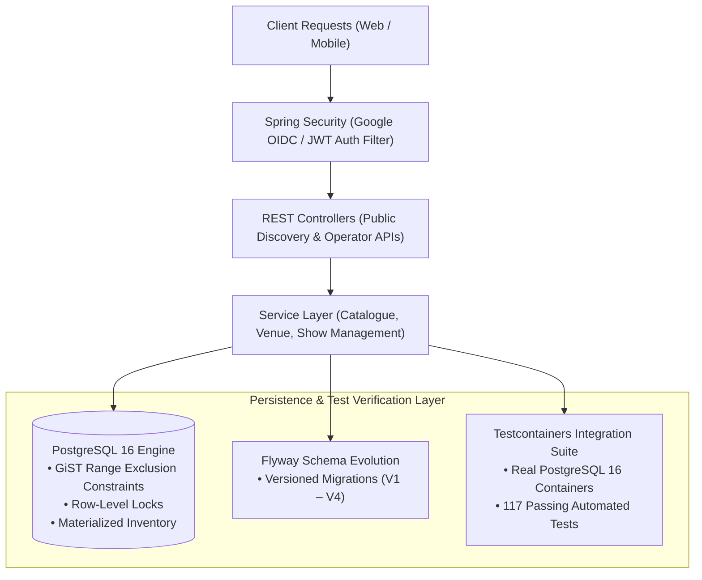

# BookIt Platform 🎟️
> **High-Concurrency Cinema Ticket Booking Engine**  
> Built with Java 21, Spring Boot 4, PostgreSQL 16, Redis 7, Flyway, Testcontainers, and Docker Compose.

[](https://github.com/AmanPrasadDev/bookit-platform/actions/workflows/ci.yml)
[](https://github.com/AmanPrasadDev/bookit-platform)
[](https://openjdk.org/projects/jdk/21/)
[-336791.svg)](https://www.postgresql.org/)

---

## 📌 Project Overview & Engineering Goals

BookIt is an enterprise cinema ticket-booking engine designed from first principles to solve critical distributed systems challenges: double-booking under concurrency, seat contention spikes, and financial-grade transactional integrity.

Rather than relying purely on fragile application-level checks (which fail under concurrent race conditions), the platform delegates critical invariant enforcement to the database engine and verifies all failure modes against real PostgreSQL containers:

1. **Database-Level Schedule Collision Prevention:** Enforcing temporal integrity at the database layer using PostgreSQL spatio-temporal exclusion constraints (`btree_gist`), guaranteeing that no auditorium screen can host overlapping showtimes.
2. **Deterministic Seat Contention Management:** Mitigating race conditions and deadlocks during concurrent multi-seat reservation attempts using ordered row-level locking (`SELECT ... FOR UPDATE` ordered by seat ID).
3. **Auditable Venue Topology:** Modeling physical auditorium layouts as immutable, versioned seat-map snapshots (`SeatMapVersion`), throwing `SeatMapImmutableException` on modifications to published maps to protect historical bookings.
4. **Integration Test Rigor:** Verifying real database constraints, ACID transactions, and security flows against PostgreSQL 16 Docker containers using **Testcontainers** (avoiding in-memory mock databases that mask locking behavior).

---

## 🏗️ Architecture & Component Boundaries



### 1. Database-Level Schedule Integrity (Flyway V4)
Cinema management requires that no two active shows overlap on the same physical screen. In BookIt, this invariant is enforced inside PostgreSQL via the `btree_gist` extension using a spatio-temporal exclusion constraint:

```sql
-- Flyway Migration: V4__create_shows_and_inventory_schema.sql
CREATE EXTENSION IF NOT EXISTS btree_gist;

ALTER TABLE show
  ADD CONSTRAINT no_overlapping_screen_shows EXCLUDE USING gist (
      screen_id WITH =,
      tstzrange(starts_at, ends_at, '[)') WITH &&
  ) WHERE (status != 'CANCELLED');
```

* **How it works:** `tstzrange(starts_at, ends_at, '[)')` defines a half-open timestamp range. If an insert or update collides with an existing active show on that screen, PostgreSQL immediately raises an exclusion constraint violation (`23P01`).
* **Half-Open Interval:** A show ending at 21:00 and another starting at 21:00 do not collide because the range is `[)` (end time is exclusive).
* **Cancelled Shows:** The partial predicate `WHERE (status != 'CANCELLED')` ensures that cancelled screenings immediately release their time window for re-allocation.
* **Test Verification:** Verified in `ShowRepositoryIntegrationTest.java` against a containerized PostgreSQL instance, validating collision rejection, adjacent non-overlapping shows, and cancelled show re-allocation.

### 2. Concurrency & Deadlock Mitigation (In Progress)
During reservation spikes, multiple users frequently attempt to book adjacent seats simultaneously:
* **The Approach:** When reserving a batch of seats, the application locks target `show_seat` records using row-level locking (`SELECT ... FOR UPDATE`).
* **Deadlock Reduction:** To eliminate circular wait conditions between concurrent multi-seat requests, seat IDs are sorted deterministically before acquiring locks:
  ```sql
  SELECT * FROM show_seat 
  WHERE id IN (:seatIds) 
  ORDER BY id ASC 
  FOR UPDATE;
  ```
* **Status:** The state machine and entity models are implemented with `@Version` optimistic locking. Multithreaded stress testing to verify deadlock-free execution under 500-thread concurrent load is the active milestone target.

### 3. Modular Security & Token Authentication
* **Identity:** Google OpenID Connect (OIDC) integration for third-party identity verification.
* **Stateless Tokens:** Cryptographic JWT generation and validation using HMAC-SHA256 (`JwtService`) with dual-token rotation.
* **Authorization:** Role-Based Access Control (`UserRole`) separating public discovery endpoints from operator management APIs (`/operator/**`).

---

## 🛠️ Technology Stack

| Component | Technology | Purpose in BookIt |
| :--- | :--- | :--- |
| **Language** | Java 21 (LTS) | Records, sealed classes, pattern matching |
| **Framework** | Spring Boot 4 | WebMVC, Security, Data JPA, Actuator |
| **Database** | PostgreSQL 16 | Relational persistence, GiST range exclusion constraints |
| **Schema Evolution**| Flyway | Versioned database schema migrations (`V1`–`V4`) |
| **Testing** | JUnit 5, Mockito, Testcontainers | Unit testing and real PostgreSQL integration tests |
| **Local Infrastructure** | Docker Compose | Local PostgreSQL 16, Redis 7, and Kafka KRaft |
| **Build & CI** | Maven, GitHub Actions | Multi-stage build and automated test verification |

---

## 🧪 Testing & Verification

The test suite distinguishes in-memory unit tests from database-backed integration tests:
* **117 passing automated tests** across 15 test classes:
  * **Unit Tests:** Service and domain logic (e.g., `VenueManagementServiceTest`, `CatalogueQueryServiceTest`, `JwtServiceTest`) tested in-memory with JUnit 5 and Mockito.
  * **Integration Tests:** Database constraints, Flyway migrations, and web layers (e.g., `ShowRepositoryIntegrationTest`, `CatalogueRepositoryIntegrationTest`, `OperatorVenueControllerIntegrationTest`, `SecurityIntegrationTest`) tested against real PostgreSQL 16 Docker containers using **Testcontainers**.

### Running the Test Suite
On Linux/macOS:
```bash
./mvnw clean test
```

On Windows (Command Prompt / PowerShell):
```cmd
.\mvnw.cmd clean test
```

---

## 🚀 Local Development Setup

### Prerequisites
- Java 21 JDK (Eclipse Temurin recommended)
- Docker Desktop
- Git

### 1. Clone & Configure Environment
```bash
git clone https://github.com/AmanPrasadDev/bookit-platform.git
cd bookit-platform
```

Copy the example environment configuration (contains only non-sensitive local defaults):
* On Linux/macOS: `cp .env.example .env.local`
* On Windows: `copy .env.example .env.local`

### 2. Start Local Database Infrastructure
```bash
docker compose --env-file .env.local up -d
```
*Starts PostgreSQL 16 on port `5432`, Redis 7 on port `6379`, and Kafka KRaft on port `9092`.*

### 3. Run the Application
On Linux/macOS:
```bash
./mvnw spring-boot:run -Dspring-boot.run.profiles=local
```

On Windows:
```cmd
.\mvnw.cmd spring-boot:run -Dspring-boot.run.profiles=local
```

Access Swagger UI & Actuator:
- Swagger UI: `http://localhost:8080/swagger-ui/index.html`
- Health Check: `http://localhost:8080/actuator/health`

---

## 🗺️ Implementation Status & Roadmap

- [x] **Milestone 0 (Complete):** Project Skeleton, Docker Compose (PostgreSQL 16, Redis 7, Kafka KRaft), Maven Wrapper, CI Pipeline.
- [x] **Milestone 1 (Complete):** Identity & Access Management (Google OIDC, Dual-Token JWT Rotation, RBAC Filters).
- [x] **Milestone 2 (Complete):** Catalogue & Venue Domain (Auditorium screens, versioned immutable seat maps, public discovery APIs, operator venue management).
- [x] **Milestone 3 (Core Schema & Repositories Verified):** Showtimes & Inventory Engine (Flyway V4, PostgreSQL GiST range exclusion constraints, pricing configurations, atomic materialized `show_seat` inventory, 8 repository integration tests).
- [ ] **Milestone 4 (In Progress):** High-Concurrency Seat Holds & Invariant Verification (Ordered `SELECT ... FOR UPDATE` locking, Redis distributed locks, 500-thread concurrent booking test).
- [ ] **Milestone 5 (Planned):** Snapshot Quoting & Financial Accuracy Engine (`BigDecimal` Money VO, immutable quote snapshots).
- [ ] **Milestone 6 (Planned):** Booking Orchestration & Payment Provider Adapters (Idempotent state machine, sandbox payment callback verification).
- [ ] **Milestone 7 (Planned):** QR Ticket Issuance & Cryptographic Scan Validation.
- [ ] **Milestone 8 (Planned):** Transactional Outbox Pattern & Kafka KRaft Event Streaming.
- [ ] **Milestone 9 (Planned):** Asynchronous Workers (`SKIP LOCKED` hold expiry & payment reconciliation).
- [ ] **Milestone 10 (Planned):** Asynchronous Notifications (Kafka consumer + DLQ).
- [ ] **Milestone 11 (Planned):** Redis Cache-Aside & Distributed Rate Limiting.
- [ ] **Milestone 12 (Planned):** Distributed Tracing & Observability (Micrometer, Prometheus, Grafana, Jaeger).

---

## 👤 Author
**Aman Prasad** — [GitHub](https://github.com/AmanPrasadDev) · [LinkedIn](https://www.linkedin.com/in/aman-prasad-42a88a26b/)
